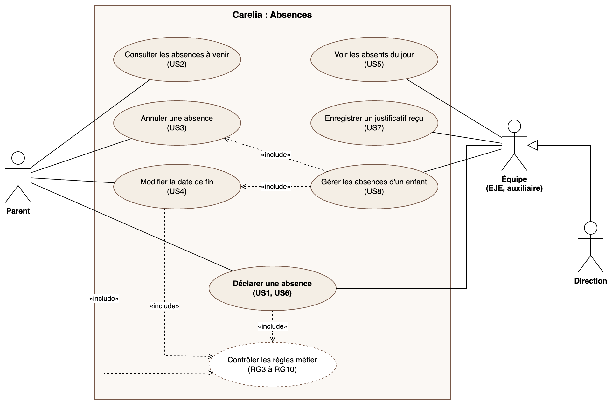

# Expression des besoins : F3 Absences

## Contexte

Aujourd'hui, quand un enfant ne vient pas à la crèche, les parents préviennent par téléphone ou pas du tout.
L'équipe découvre l'absence le matin et ne connaît pas toujours la raison, alors que la crèche doit la connaître.

La fonctionnalité **Absences** permet de déclarer à l'avance l'absence d'un enfant, avec son motif,
et donne à l'équipe la liste des enfants absents du jour.

## Acteurs

| Acteur | Rôle dans l'application | Ce qu'il fait |
| --- | --- | --- |
| Parent | `PARENT` | Déclare, consulte et annule les absences de **ses** enfants |
| Équipe | `EJE`, `AUXILIARY` | Déclare une absence pour un parent qui appelle, consulte les absents du jour, enregistre la réception d'un justificatif |
| Direction | `DAYCARE_ADMIN` | Mêmes droits que l'équipe |

## Besoins fonctionnels

1. **Déclarer une absence** pour un enfant, sur un jour ou une période (date de début, date de fin),
   avec un motif et un commentaire.
2. **Consulter les absences à venir** de ses enfants (parent).
3. **Annuler une absence** qui n'a pas encore commencé.
4. **Modifier la date de fin** d'une absence (par exemple, enfant guéri plus tôt ou malade plus longtemps).
5. **Voir les enfants absents du jour** sur l'accueil (équipe), avec le motif.
6. **Enregistrer la réception d'un justificatif** (équipe) : le parent remet le papier à la crèche,
   l'équipe coche « justificatif reçu ».

## Motifs

| Motif | Catégorie | Justificatif | Commentaire |
| --- | --- | --- | --- |
| Maladie | à justifier | attendu (peut être remis après l'absence) | facultatif |
| Rendez-vous (médical ou autre) | à justifier | attendu (peut être remis après l'absence) | facultatif |
| Absence injustifiée (vacances, convenance personnelle…) | injustifiée | aucun | **obligatoire** (la crèche doit connaître la raison) |

## Règles métier

| N° | Règle |
| --- | --- |
| RG1 | Un parent ne peut déclarer, voir, modifier ou annuler que les absences de **ses propres enfants**. |
| RG2 | Un membre de l'équipe ne peut agir que sur les enfants de **sa crèche**. |
| RG3 | **Pas de date passée** : la date de début est aujourd'hui ou plus tard. Une absence oubliée n'est pas déclarée après coup. |
| RG4 | La date de fin est égale ou postérieure à la date de début. |
| RG5 | Une absence **maladie** ou **rendez-vous** peut être déclarée le jour même (en pratique, le matin de l'absence). |
| RG6 | Une absence **injustifiée** déclarée par un **parent** doit l'être **au moins 48 h avant** son début. L'équipe n'est pas soumise à ce délai (elle enregistre l'appel tardif d'un parent). |
| RG7 | Une absence **injustifiée** doit avoir un **commentaire** expliquant la raison. |
| RG8 | Un enfant ne peut pas avoir **deux absences qui se chevauchent**. |
| RG9 | Une absence ne peut être **annulée** que si elle **n'a pas commencé**. |
| RG10 | La **date de fin** peut être modifiée par le parent ou l'équipe, seulement si elle est à **plus de 24 h** (pas si la fin est aujourd'hui ou demain). La nouvelle date respecte RG4 et RG8. |
| RG11 | Seule l'équipe peut indiquer qu'un **justificatif a été reçu**, pendant l'absence ou dans les **7 jours** qui suivent sa fin. Pour cela, l'équipe voit aussi les absences maladie ou rendez-vous terminées depuis moins de 7 jours. |

## User stories

Priorités : **Indispensable** (version minimale), **Importante**, **Bonus** (si le temps le permet).
Les critères d'acceptation renvoient aux règles métier ; ils serviront de base aux tests et à la recette.

### Parent

**US1 : Déclarer une absence** (Indispensable)
En tant que parent, je veux déclarer l'absence de mon enfant (un jour ou une période) avec un motif,
afin que la crèche soit prévenue et connaisse la raison.
- Je ne peux choisir que mes enfants (RG1).
- La date de début ne peut pas être passée (RG3) ; la date de fin n'est pas avant le début (RG4).
- Maladie ou rendez-vous : je peux déclarer le jour même (RG5).
- Injustifiée : refusée si elle commence dans moins de 48 h (RG6), et le commentaire est obligatoire (RG7).
- Refusée si elle chevauche une absence existante de l'enfant (RG8).
- Après validation, l'absence apparaît dans la liste des absences à venir.

**US2 : Consulter les absences à venir** (Indispensable)
En tant que parent, je veux voir les absences à venir de mon enfant,
afin de vérifier ce que j'ai déclaré.
- Je ne vois que les absences de mes enfants (RG1).
- Pour chaque absence : dates, motif, et pour maladie ou rendez-vous, « justificatif reçu » ou « justificatif attendu ».

**US3 : Annuler une absence** (Importante)
En tant que parent, je veux annuler une absence qui n'a pas commencé,
afin que la crèche sache que mon enfant viendra finalement.
- Le bouton n'apparaît que si l'absence n'a pas commencé (RG9), et une confirmation est demandée.
- Je ne peux annuler que les absences de mes enfants (RG1).

**US4 : Modifier la date de fin** (Importante)
En tant que parent, je veux changer la date de fin d'une absence,
afin de prévenir si mon enfant revient plus tôt ou plus tard.
- Possible seulement si la date de fin actuelle est à plus de 24 h (RG10).
- La nouvelle date respecte RG4 et ne crée pas de chevauchement (RG8).

### Équipe (EJE, auxiliaire, direction)

**US5 : Voir les absents du jour** (Indispensable)
En tant que membre de l'équipe, je veux voir sur mon tableau de bord les enfants absents aujourd'hui,
afin d'organiser la journée dès le matin.
- Seuls les enfants de ma crèche apparaissent (RG2).
- Pour chacun : prénom, nom, motif.

**US6 : Déclarer une absence pour un parent** (Importante)
En tant que membre de l'équipe, je veux déclarer une absence quand un parent appelle,
afin que l'information soit dans l'application même si le parent ne l'a pas saisie.
- Je choisis un enfant de ma crèche (RG2).
- Mêmes règles que US1, sauf le délai de 48 h qui ne s'applique pas (RG6).
- L'absence indique qui l'a déclarée.

**US7 : Enregistrer un justificatif reçu** (Importante)
En tant que membre de l'équipe, je veux indiquer qu'un justificatif a été remis,
afin de savoir quelles absences sont justifiées.
- Seule l'équipe peut le faire (RG11), pour une absence maladie ou rendez-vous.
- Possible pendant l'absence et jusqu'à 7 jours après sa fin (RG11).

**US8 : Gérer les absences depuis la fiche enfant** (Bonus)
En tant que membre de l'équipe, je veux consulter, modifier ou annuler les absences d'un enfant depuis sa fiche,
afin de corriger une erreur ou suivre un appel du parent.
- Mêmes règles que US3 et US4, limitées aux enfants de ma crèche (RG2).

## Diagramme de cas d'utilisation

La direction hérite des cas de l'équipe. Tous les cas nécessitent d'être connecté.

Source modifiable : [`cas-utilisation.drawio`](cas-utilisation.drawio) (à ouvrir avec draw.io / app.diagrams.net).

## Hors périmètre (pour l'instant)

- Historique des absences passées et statistiques (seule exception : les absences à justifier terminées
  depuis moins de 7 jours restent visibles pour l'équipe, RG11).
- Envoi du justificatif par fichier (photo, PDF) : données de santé, trop sensibles pour cette version.
- Prise en compte des vacances scolaires.
