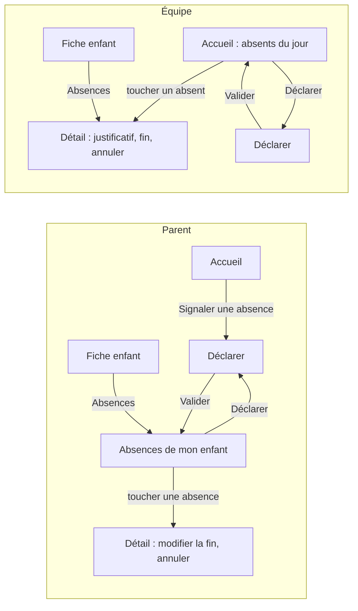

# Inventaire des écrans et navigation

Base des maquettes Figma (format mobile). L'application a deux espaces selon le rôle :
**parent** et **équipe** (direction, EJE, auxiliaire).
Navigation principale : barre d'onglets en bas de l'écran (5 onglets maximum).

Légende : ✅ existe déjà (à redessiner), 🆕 nouveau (F3 Absences).

## Commun

| N° | Écran | Route | |
| --- | --- | --- | --- |
| E1 | Connexion | (avant authentification) | ✅ |
| E2 | Page introuvable | `*` | ✅ |

## Espace parent

Onglets : **Accueil · Mon enfant · Bulletins · Messages · Mon espace**

| N° | Écran | Route | Contenu | |
| --- | --- | --- | --- | --- |
| P1 | Accueil | `/` | La journée de l'enfant en un regard, mot de l'équipe, à suivre ; raccourci « Signaler une absence » | ✅ + 🆕 raccourci |
| P2 | Mes enfants | `/enfants` | Liste des enfants du parent | ✅ |
| P3 | Fiche de mon enfant | `/enfants/:id` | Informations de l'enfant ; accès à ses absences | ✅ + 🆕 lien |
| P4 | Bulletins | `/bulletins` | Les journées de l'enfant | ✅ |
| P4b | Bulletin publié (lecture) | `/bulletin` | Déroulé de la journée : siestes, changes, humeurs, observations, activités, mot de l'équipe | ✅ |
| P5 | Messages | `/messages` | Liste des conversations, recherche, bloc « Écrire à la crèche » | ✅ |
| P6 | Conversation | `/messages/:id` | Fil de discussion | ✅ |
| P7 | Notifications | `/notifications` | Nouveaux bulletins et messages | ✅ |
| P8 | Mon espace | `/plus` | Profil, liens, déconnexion | ✅ |
| P9 | Absences de mon enfant | 🆕 | Absences à venir (motif, dates, justificatif reçu ou non) ; bouton « Déclarer » | 🆕 |
| P10 | Déclarer une absence | 🆕 | Enfant, date de début, date de fin, motif, commentaire | 🆕 |
| P11 | Détail d'une absence | 🆕 | Modifier la date de fin (RG10), annuler (RG9) | 🆕 |

## Espace équipe

Onglets : **Accueil · Enfants · Bulletins · Messages · Plus**
(l'auxiliaire n'a pas la messagerie)

| N° | Écran | Route | Contenu | |
| --- | --- | --- | --- | --- |
| S1 | Accueil (tableau de bord) | `/` | Bulletins du jour, à faire, bulletins récents ; **bloc « Absents du jour »** | ✅ + 🆕 bloc |
| S2 | Enfants | `/enfants` | Liste des enfants de la crèche | ✅ |
| S3 | Fiche enfant | `/enfants/:id` | Informations, contacts ; « Modifier la fiche », « Lier un parent », confirmation « Délier ce parent ? » ; accès à ses absences | ✅ + 🆕 lien |
| S4 | Nouvel enfant | `/enfants/nouveau` | Formulaire de création | ✅ |
| S5 | Bulletins | `/bulletins` | Historique des journées | ✅ |
| S6 | Saisie du bulletin | `/bulletin` | Choix de l'enfant et de la date ; changes, siestes, humeurs/observations, activités ; confirmation « Relire avant publication » | ✅ |
| S7 | Messages | `/messages` | Conversations avec les familles, recherche, « Écrire à un parent » (choix de l'enfant puis du parent) | ✅ |
| S8 | Conversation | `/messages/:id` | Fil de discussion | ✅ |
| S9 | Notifications | `/notifications` | Nouveaux messages | ✅ |
| S10 | Plus | `/plus` | Profil, liens, déconnexion | ✅ |
| S11 | Déclarer une absence | 🆕 | Même formulaire que P10, avec choix de l'enfant (appel d'un parent) | 🆕 |
| S12 | Détail d'une absence | 🆕 | Comme P11, plus la case « Justificatif reçu » (RG11) | 🆕 |

## Administration (direction ; les EJE consultent sans modifier)

La page existe et fonctionne, mais aucun menu n'y mène : un lien « Utilisateurs » sera ajouté dans
l'écran Plus (S10) lors de la refonte.

| N° | Écran | Route | Contenu | |
| --- | --- | --- | --- | --- |
| A1 | Utilisateurs | `/utilisateurs` | Liste des comptes (nom, rôle, e-mail, actif ou non), recherche, « Créer un compte » | ✅ (sans accès menu) |
| A2 | Créer / modifier un compte | `/utilisateurs` | Prénom, nom, e-mail, rôle, téléphone, mot de passe, compte actif ; « Supprimer le compte » avec confirmation | ✅ |

Non repris dans les maquettes : pages présentes dans le code mais vides et non accessibles
(Agenda, Santé & PAI).

## Enchaînement des écrans F3 Absences

